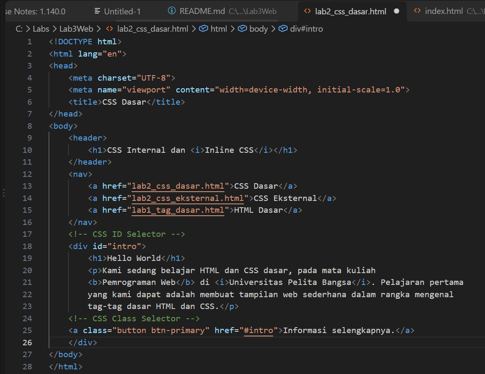
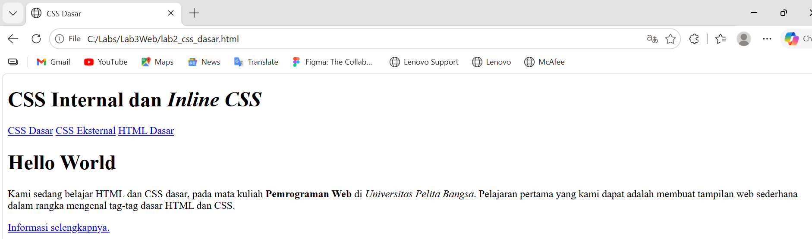
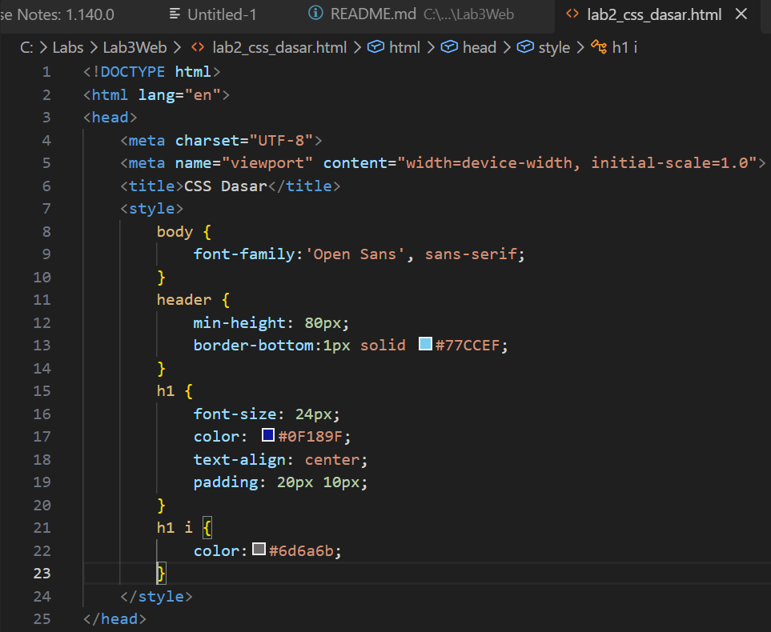
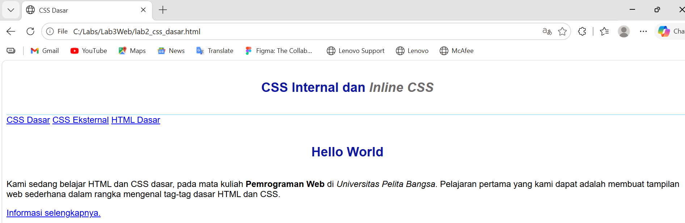
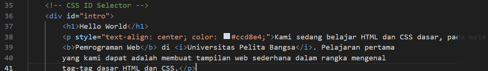
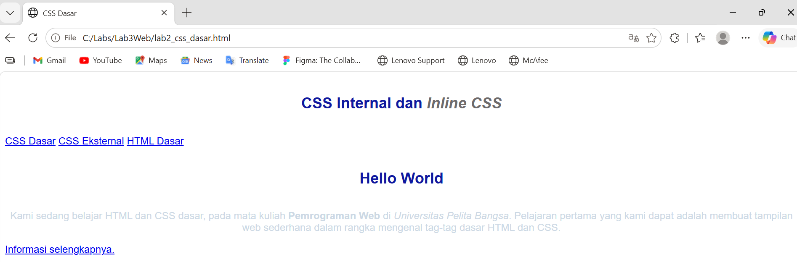
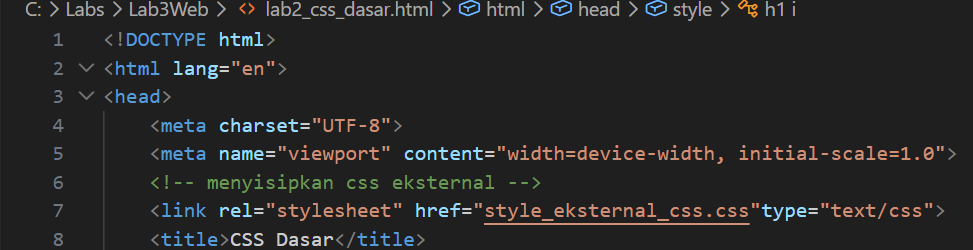
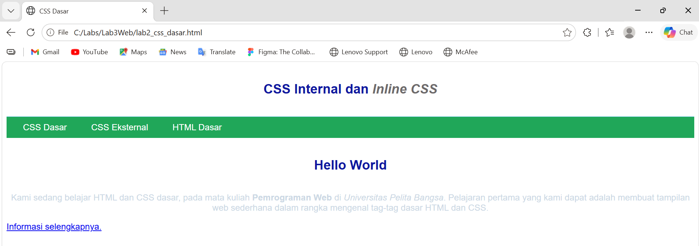
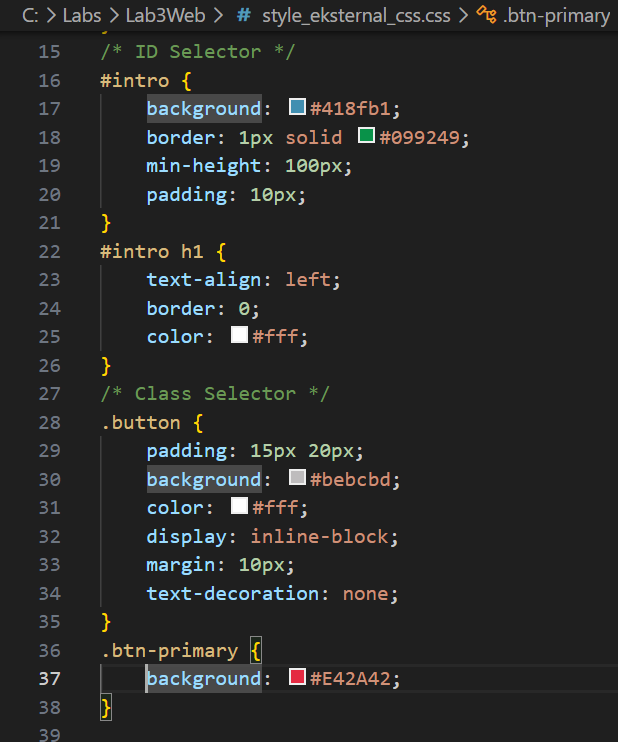
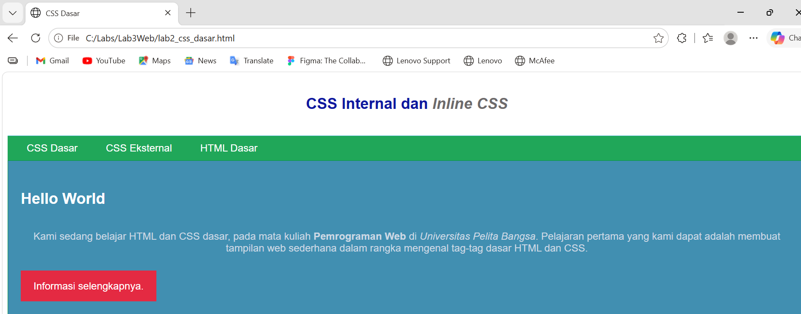

# Lab3Web

## 1. Membuat CSS Dasar

Berikut, Outputnya :

## 2. Menambahkan CSS Internal
Tambahkan deklarasi CSS internal pada bagian *head*.

Berikut, Outputnya :

## 3. Menambahkan Inline CSS
Tambahkan deklarasi Inline CSS pada tag *p* yang berfungsi mempengaruhi satu bagian baris kode.

Berikut, Outputnya :

## 4. Membuat CSS Eksternal
Buat file baru dengan nama **style_eksternal.css** lalu deklarasikan.

Berikut, Outputnya :

## 5. Menambahkan CSS Selector
Tambahkan CSS Selector menggunakan ID dan Class Selector di file **style_eksternal.css**.

Berikut, Outputnya :

